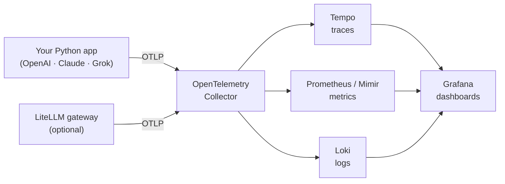

# llm-otel-lgtm by itzvadi

Monitor **OpenAI ChatGPT, Anthropic Claude and xAI Grok** in one place with **OpenTelemetry** and the **Grafana LGTM** stack (Loki, Grafana, Tempo, Mimir/Prometheus). It comes with pre-built dashboards and runs on a laptop or on Kubernetes for a whole company.

## How it works



1. Your app calls an LLM through `llm_telemetry.chat()` (or through the optional gateway).
2. Each call sends a **trace**, **metrics** (requests, tokens, cost, latency) and a **log event** to the collector.
3. The collector stores them in Tempo, Prometheus/Mimir and Loki.
4. Grafana shows everything on ready-made dashboards.

## Quick start (5 minutes, no API keys needed)

Requires Docker with Compose.

```bash
cd deploy/local
cp .env.example .env
docker compose --profile demo up -d      # stack + simulated traffic
```

Open **http://localhost:3000**. The dashboards are in the **LLM Observability** folder and fill up within about a minute.

Stop everything with `docker compose --profile demo down`.

## Choose your options

All options live in `deploy/local/.env`.

| Option | Values | What it does |
|---|---|---|
| `PROMPT_LOGGING` | `off` (default) / `on` | `off`: only metadata is stored (tokens, model, latency, cost), and the collector strips any prompt text it receives. `on`: prompts and responses are stored in Loki and shown on the *Traces & Logs* dashboard. |
| Gateway | add `--profile gateway` | Starts a LiteLLM proxy on `http://localhost:4000`, so apps can be traced without code changes. |
| `LLM_MOCK` | `true` / `false` | The demo generator simulates traffic (`true`) or makes real API calls (`false`, needs keys). |

Example with everything on:

```bash
PROMPT_LOGGING=on docker compose --profile gateway --profile demo up -d
```

## Option A: instrument your Python app

```bash
pip install -r instrumentation/python/requirements.txt
export OTEL_EXPORTER_OTLP_ENDPOINT=http://localhost:4318
export OTEL_SERVICE_NAME=my-app
export PROMPT_LOGGING=off
```

```python
import llm_telemetry

llm_telemetry.setup()

msgs = [{"role": "user", "content": "Hello!"}]
llm_telemetry.chat("openai",    "gpt-4o-mini",       msgs)  # OPENAI_API_KEY
llm_telemetry.chat("anthropic", "claude-haiku-4-5",  msgs)  # ANTHROPIC_API_KEY
llm_telemetry.chat("xai",       "grok-3-mini",       msgs)  # XAI_API_KEY

llm_telemetry.shutdown()
```

See `instrumentation/python/examples/quickstart.py`.

## Option B: use the gateway (no code changes)

Start the stack with `--profile gateway`, then point any OpenAI-compatible client at the proxy:

```python
from openai import OpenAI
client = OpenAI(base_url="http://localhost:4000", api_key="anything")
client.chat.completions.create(model="claude-sonnet-4-5", messages=[{"role": "user", "content": "Hi"}])
```

Models are listed in `gateway/litellm/config.yaml`. Gateway calls show up as traces in Tempo; the metric dashboards are fed by the Python library.

## Dashboards

| Dashboard | Shows |
|---|---|
| **LLM Overview** | Requests, tokens, cost, error rate, p95 latency by provider |
| **LLM Provider Comparison** | Scorecard of every provider/model: latency, errors, tokens, cost per request |
| **LLM Cost & Tokens** | Spend, projected daily spend, spend share, token usage |
| **LLM Latency & Errors** | p50/p95/p99, time to first token, error rate, errors by type (e.g. 429) |
| **LLM Traces & Logs** | Recent, slow and failed traces, request logs, prompts (if enabled) |

Every dashboard can be filtered by **service**, **provider** and **model**.

## What is collected

| Signal | Name | Labels |
|---|---|---|
| Metric | `llm_requests_total` | provider, model, status, error_type |
| Metric | `llm_tokens_total` | provider, model, token_type |
| Metric | `llm_cost_usd_total` | provider, model |
| Metric | `llm_request_duration_seconds` | provider, model, status |
| Metric | `llm_time_to_first_token_seconds` | provider, model |
| Trace | span `chat <model>` | OpenTelemetry GenAI attributes (`gen_ai.system`, `gen_ai.usage.*`, …) |
| Log | `llm.request` | metadata only |
| Log | `gen_ai.content` | prompt and response, only with `PROMPT_LOGGING=on` |

Cost uses the prices in `instrumentation/python/llm_telemetry/pricing.yaml`. The values there are **examples**; update them to current provider prices.

## Repository layout

```
deploy/local/            docker compose for local use
collector/               OpenTelemetry Collector configs (prompts off / on)
gateway/litellm/         optional LiteLLM gateway config
instrumentation/python/  llm_telemetry library + examples
grafana/                 datasources, dashboard provisioning, dashboards
scripts/                 dashboard generator
docs/                    enterprise deployment guide
```

To change a dashboard, edit `scripts/generate_dashboards.py` and run `python scripts/generate_dashboards.py`.

## Enterprise

See [docs/enterprise.md](docs/enterprise.md) for Kubernetes, multi-tenancy, SSO and retention.
