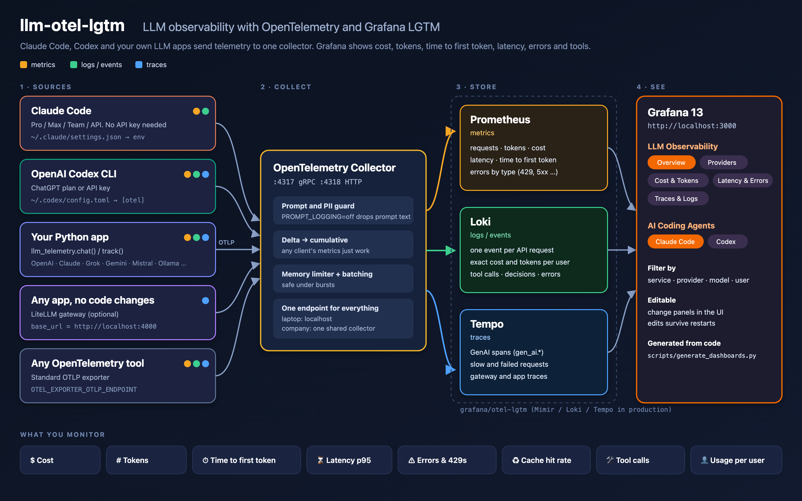
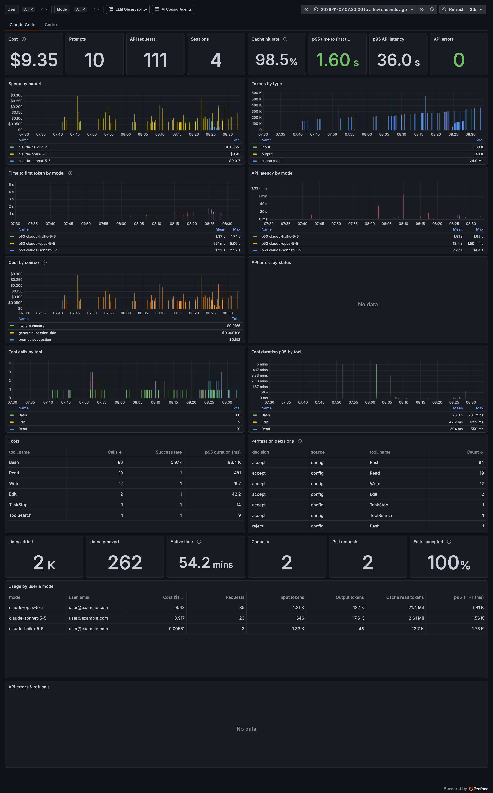
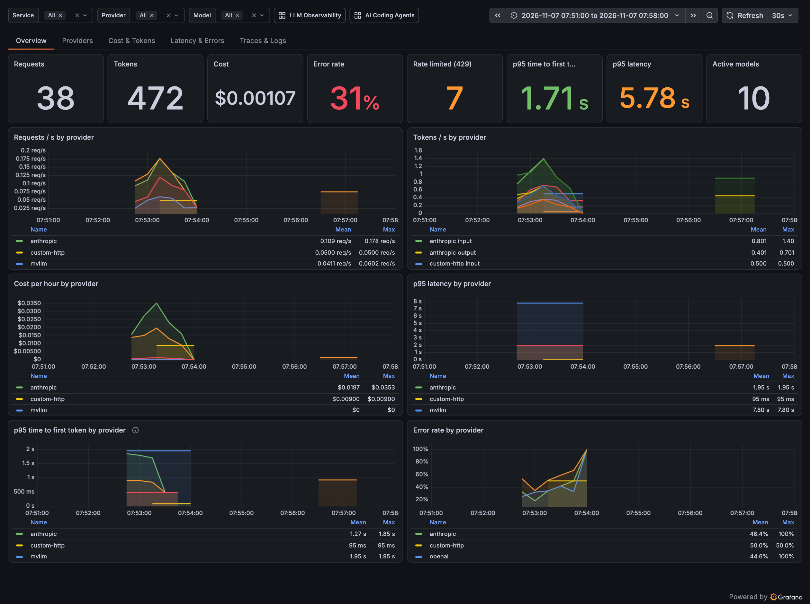

# llm-otel-lgtm by itzvadi

Monitor **Claude Code, OpenAI Codex and your own LLM apps** (OpenAI, Anthropic Claude, xAI Grok, Gemini,
Mistral, Ollama and any OpenAI-compatible model) in one place, with **OpenTelemetry** and the
**Grafana LGTM** stack (Loki, Grafana, Tempo, Prometheus/Mimir).

It runs on a laptop in five minutes or on Kubernetes for a whole company, and ships with tabbed
Grafana 13 dashboards you can edit in the UI.



## Quick start

Requires Docker with Compose. On macOS without Docker Desktop:
`brew install colima docker docker-compose && colima start`.

### Option 1: setup wizard (recommended)

```bash
git clone https://github.com/itzvadi/llm-otel-lgtm
cd llm-otel-lgtm
python3 setup_wizard.py
```

The wizard asks a few questions and then does the rest:

1. Checks for Docker, Claude Code and Codex.
2. Asks which sources you use, whether to store prompt text, and whether to use a local stack or a
   company collector.
3. Adds the telemetry settings to `~/.claude/settings.json` and `~/.codex/config.toml`. Each file is
   backed up first, and your other settings are kept.
4. Starts the stack and sends a test event end to end.

It needs only Python 3.9+, with no extra packages.

| Command | Does |
|---|---|
| `python3 setup_wizard.py --dry-run` | Shows what would change, without changing anything |
| `python3 setup_wizard.py --yes --sources claude,codex` | Runs without questions, for scripts and fleet rollout |
| `python3 setup_wizard.py --yes --collector http://otel.example.com:4317 --sources claude` | Points the tools at a shared collector |
| `python3 setup_wizard.py --uninstall` | Removes the settings it added |

### Option 2: manual

```bash
git clone https://github.com/itzvadi/llm-otel-lgtm
cd llm-otel-lgtm/deploy/local
cp .env.example .env
docker compose up -d
```

Open **http://localhost:3000**. The stack starts empty, with no simulated data. Connect a source and
its data appears within seconds:

| You use | Do this | See it in |
|---|---|---|
| **Claude Code** (any plan, no API key) | Add the telemetry `env` block to `~/.claude/settings.json` | AI Coding Agents → Claude Code |
| **Codex CLI** (ChatGPT plan or API key) | Add an `[otel]` section to `~/.codex/config.toml` | AI Coding Agents → Codex |
| **Your Python app** | `pip install` the library and call `llm_telemetry.chat()` or wrap calls in `track()` | LLM Observability |
| **Any app, no code changes** | Start with `--profile gateway` and point it at `http://localhost:4000` | LLM Observability → Traces & Logs |

**➡ Step-by-step setup for each one, including how to add any other LLM: [docs/add-your-llm.md](docs/add-your-llm.md)**

The shortest path, if you use Claude Code, is to put this in `~/.claude/settings.json` and restart it:

```json
{
  "env": {
    "CLAUDE_CODE_ENABLE_TELEMETRY": "1",
    "OTEL_METRICS_EXPORTER": "otlp",
    "OTEL_LOGS_EXPORTER": "otlp",
    "OTEL_EXPORTER_OTLP_PROTOCOL": "grpc",
    "OTEL_EXPORTER_OTLP_ENDPOINT": "http://localhost:4317",
    "OTEL_EXPORTER_OTLP_METRICS_TEMPORALITY_PREFERENCE": "cumulative"
  }
}
```

Stop the stack with `docker compose down`. Data and dashboard edits are kept in Docker volumes; add `-v`
to delete them.

## Screenshots

Captured from the running stack on 2026-11-07, with each time range zoomed to when that traffic ran.
Emails and local paths are redacted.

**AI Coding Agents**: real Claude Code (Pro plan) and Codex CLI (ChatGPT plan) sessions.

[](docs/screenshots/ai-coding-agents-claude-code.png)

| Tab | Screenshot |
|---|---|
| Claude Code | [cost, tokens, time to first token, tools, decisions, lines of code](docs/screenshots/ai-coding-agents-claude-code.png) |
| Codex | [tokens, cached input, time to first token, API status, conversations](docs/screenshots/ai-coding-agents-codex.png) |

**LLM Observability**: the Python library's end-to-end test. The OpenAI, Anthropic and xAI SDKs, a
custom provider and the gateway ran against a local API stand-in. Models named `*-ratelimit`, `*-boom`
and `*-slow` deliberately return 429s, 500s and slow responses.

[](docs/screenshots/llm-observability-overview.png)

| Tab | Screenshot |
|---|---|
| Overview | [requests, tokens, cost, error rate, 429s, time to first token, latency](docs/screenshots/llm-observability-overview.png) |
| Providers | [scorecard, p95 latency and cost per 1k requests by model](docs/screenshots/llm-observability-providers.png) |
| Cost & Tokens | [spend, projected spend, spend share, tokens by model](docs/screenshots/llm-observability-cost-tokens.png) |
| Latency & Errors | [latency and time-to-first-token percentiles, errors by type, rate limits](docs/screenshots/llm-observability-latency-errors.png) |
| Traces & Logs | [recent, slow and failed traces, request events](docs/screenshots/llm-observability-traces-logs.png) |

## Dashboards

Both dashboards are in the **LLM Observability** folder, use tabs, and can be filtered by the variables
at the top.

**LLM Observability**, for apps using the Python library or gateway. Filters: service, provider, model.

| Tab | Shows |
|---|---|
| Overview | Requests, tokens, cost, error rate, 429s, p95 time to first token, p95 latency, by provider |
| Providers | Scorecard per provider/model: latency, errors, tokens, cost per request |
| Cost & Tokens | Spend, projected daily spend, spend share, tokens by model |
| Latency & Errors | Latency and time-to-first-token percentiles by model, errors by type, rate limits |
| Traces & Logs | Recent, slow and failed traces, request events, prompts (if enabled) |

**AI Coding Agents**, for Claude Code and Codex CLI. Filters: user, model.

| Tab | Shows |
|---|---|
| Claude Code | Cost, prompts, requests, sessions, cache hit rate, time to first token, API latency, errors, spend by model and source, tool calls (success rate, duration), permission decisions, lines of code, commits, PRs, usage per user |
| Codex | Prompts, responses, input/cached/output/reasoning tokens, time to first token (turn and response), turn duration, API latency and status codes, failures, tool calls and decisions, conversations by model and settings, usage per user |

Totals on the agent tabs are added up from per-request log events, so they are exact even for short CLI
sessions.

### Editing dashboards

- **In the UI:** edit and save as usual. Changes are stored in Grafana's volume and survive restarts.
  Export the JSON (Edit → Export) to keep a change in git.
- **As code:** edit `scripts/generate_dashboards.py`, then run:

  ```bash
  python scripts/generate_dashboards.py
  docker compose -f deploy/local/docker-compose.yml restart grafana
  ```

  Regenerating overwrites UI edits to the same dashboard.

## Options

All options live in `deploy/local/.env`.

| Option | Values | What it does |
|---|---|---|
| `PROMPT_LOGGING` | `off` (default) / `on` | `off`: only metadata is stored (tokens, model, latency, cost). The collector strips prompt and response text from every source, including Claude Code and Codex, even when a client is set to send it. `on`: prompts and responses are kept in Loki. |
| Gateway | `--profile gateway` | Starts a LiteLLM proxy on `http://localhost:4000`. Apps send `LITELLM_MASTER_KEY` (default `sk-local-dev`) as their API key. |
| `LGTM_VERSION`, `COLLECTOR_VERSION`, `GRAFANA_VERSION`, `LITELLM_VERSION` | image tags | Pinned by default for reproducible installs. |

```bash
PROMPT_LOGGING=on docker compose --profile gateway up -d
```

## What is collected

**From the Python library** (`llm_telemetry`):

| Signal | Name | Labels |
|---|---|---|
| Metric | `llm_requests_total` | provider, model, status, error_type |
| Metric | `llm_tokens_total` | provider, model, token_type (`input` = uncached, `cached_input`, `output`) |
| Metric | `llm_cost_usd_total` | provider, model, token_type, pricing_version |
| Metric | `llm_request_duration_seconds` | provider, model, status |
| Metric | `llm_time_to_first_token_seconds` | provider, model |
| Trace | span `chat <model>` | OpenTelemetry GenAI attributes (`gen_ai.system`, `gen_ai.usage.*`, …) |
| Log | `llm.request` | metadata only |
| Log | `gen_ai.content` | prompt and response, only with `PROMPT_LOGGING=on` |

`error_type` is normalized across SDKs: `rate_limit_429`, `server_error_5xx`, `auth_401/403`,
`client_error_4xx`, `timeout`, `connection_error`.

**From Claude Code and Codex:** their own built-in metrics (`claude_code_*`, `codex_*`) and events
(`api_request`, `tool_result`, `codex.sse_event`, …). See [docs/add-your-llm.md](docs/add-your-llm.md).

Cost for the Python library uses `instrumentation/python/llm_telemetry/pricing.yaml`. The values are Bump `version:` in that file whenever you change a rate: cost is computed when each request is recorded and labelled with `pricing_version`, so a rate change never rewrites spend already stored. The Cost & Tokens tab splits spend into uncached input, cached input and output, and shows spend per pricing version.
**examples**: update them to current provider prices, or set `LLM_PRICING_FILE`. Claude Code reports its
own cost. Codex reports none.

## Repository layout

```
deploy/local/            docker compose for local use
collector/               OpenTelemetry Collector configs (prompts off / on)
gateway/litellm/         optional LiteLLM gateway config
instrumentation/python/  llm_telemetry library (pip-installable) + quickstart example
grafana/                 datasources, dashboard provisioning, dashboards (v2 schema, tabs)
scripts/                 dashboard generator
docs/                    connect-your-LLM guide, enterprise guide, architecture image
docs/screenshots/        dashboard screenshots
setup_wizard.py          interactive setup (python3 setup_wizard.py)
```

## Enterprise

See [docs/enterprise.md](docs/enterprise.md) for Kubernetes, multi-tenancy, SSO, retention, and
rolling out Claude Code and Codex telemetry to a whole team.
